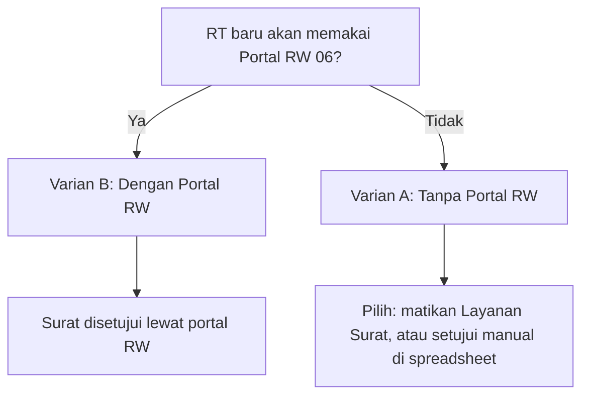

# Panduan Menyiapkan RT Baru: dari Nol sampai Siap Pakai

| Field | Nilai |
|---|---|
| Dokumen | Panduan operasional untuk menaikkan **satu RT baru** dari repo kosong sampai aplikasi berjalan |
| Berlaku untuk | RT mana pun selain RT017 (referensi) dan RT018 (pilot) |
| Varian | **A. Tanpa Portal RW** dan **B. Dengan Portal RW 06** |
| Dokumen terkait | `ROLLOUT-RT.md` (runbook ringkas), `MAINTENANCE.md` (siklus operasi), `ROLLOUT-TICKET.md` (pelacak per RT), `readme.md`, `panduan.md`, `Apps Script/readme.md`, `RW Apps Script/readme.md`, `rw/README.md`, `BRD-RW06.md` |
| Perkiraan waktu | 2-4 jam kerja langsung, lalu masa pilot 1 minggu |

Panduan ini menuliskan `RTNNN` sebagai nomor RT baru dan `rtNNN` sebagai nama branch.
Contoh: RT019 dan `rt019`. Ganti keduanya saat mengikuti langkah di bawah.

> **Aturan pokok:** jangan memakai ulang spreadsheet, proyek Apps Script, token,
> folder Drive, atau proyek Cloudflare milik RT lain. Jangan pernah me-merge branch
> `rtNNN` kembali ke `main`.

### Daftar isi

- [0. Pilih Varian Lebih Dulu](#0-pilih-varian-lebih-dulu)
- [1. Prasyarat dan Data yang Harus Dikumpulkan](#1-prasyarat-dan-data-yang-harus-dikumpulkan)
- [2. Fase 1 - Google Sheets dan Backend Apps Script](#2-fase-1---google-sheets-dan-backend-apps-script)
- [3. Fase 2 - Repo dan Branch](#3-fase-2---repo-dan-branch)
- [4. Fase 3 - Ubah `config.js`](#4-fase-3---ubah-configjs)
- [5. Fase 4 - Penanda Versi (Satu Commit)](#5-fase-4---penanda-versi-satu-commit)
- [6. Fase 5 - Kode QR Portal](#6-fase-5---kode-qr-portal)
- [7. Fase 6 - Cloudflare Pages dan Access](#7-fase-6---cloudflare-pages-dan-access)
- [8. Fase 7 - Pemeriksaan Sebelum dan Sesudah Deploy](#8-fase-7---pemeriksaan-sebelum-dan-sesudah-deploy)
- [9. Fase 8 - Smoke Test](#9-fase-8---smoke-test)
- [10. Varian A - Tanpa Portal RW](#10-varian-a---tanpa-portal-rw)
- [11. Varian B - Dengan Portal RW 06](#11-varian-b---dengan-portal-rw-06)
- [12. Fase 9 - Rollback](#12-fase-9---rollback)
- [13. Troubleshooting](#13-troubleshooting)
- [14. Checklist Copy-Paste](#14-checklist-copy-paste)

---

## 0. Pilih Varian Lebih Dulu

Sebelum menyentuh kode, tentukan apakah RT baru akan terhubung ke Portal RW 06 atau
tidak. Perbedaan utamanya ada pada cara **pengajuan surat** disetujui sebelum bisa
ditandai `Selesai`.



| Aspek | Varian A: Tanpa Portal RW | Varian B: Dengan Portal RW 06 |
|---|---|---|
| Pengajuan surat dari warga | Bisa dimatikan total, atau tetap jalan lalu disetujui manual | Normal, keputusan lewat portal RW |
| Status RW pengajuan baru | `Menunggu` (tetap dibuat oleh backend) | `Menunggu`, lalu diputuskan RW |
| Bisa menandai `Selesai`? | Setelah `Rw Status` diubah manual di spreadsheet | Setelah RW menekan `Setujui` |
| Lapor & Aspirasi | Berjalan normal tanpa RW | Bisa dieskalasi ke RW |
| Proyek tambahan | Tidak ada | Orkestrator + gateway + Access portal RW |
| Token `RW_TOKEN` / `RT_ID` | Boleh dikosongkan | Wajib, harus sama dengan orkestrator |
| Tingkat kesulitan | Rendah | Sedang |

> Portal RW bersifat **per-RW**, bukan per-RT. Untuk RT baru di lingkungan RW 06, Anda
> **tidak** membuat portal baru: Anda cukup mendaftarkan RT ke portal yang sudah ada
> (lihat Bagian 11). Membangun portal RW untuk RW yang belum punya adalah proyek
> terpisah dan di luar cakupan panduan ini (lihat `RW Apps Script/readme.md` dan
> `rw/README.md`).

---

## 1. Prasyarat dan Data yang Harus Dikumpulkan

Kegagalan cutover paling sering disebabkan nilai yang belum disiapkan. Isi tabel ini
lebih dulu.

| Nilai | Contoh | Asal |
|---|---|---|
| Nomor RT | `RT019` | Pengurus RT |
| Nama branch | `rt019` | Turunan nomor RT |
| Nama wilayah | `RT 019 / RW 06` | Pengurus RT |
| Alamat / nama kawasan | `Lontar Tengah` | Pengurus RT |
| Domain produksi | `sapa-rt019.pages.dev` | Proyek Cloudflare Pages |
| URL portal publik | `https://sapa-rt019.pages.dev/public` | Domain + `/public` |
| Email admin RT | `admin.rt019@gmail.com` | Pengurus RT |
| `ADMIN_TOKEN` | acak 32+ karakter | Dibuat baru, jangan dipakai ulang |
| `RW_TOKEN` | acak 32+ karakter | Hanya untuk Varian B, beda dari `ADMIN_TOKEN` |
| Folder Drive foto pengaduan | `Lapor RT019` | Google Drive |
| Jendela cutover | di luar jam ramai warga | Kesepakatan dengan pengurus |

Yang perlu disiapkan:

- Akun **Google** khusus RT (disarankan, agar kepemilikan berkas tidak bergantung
  pada akun pribadi).
- Akun **Cloudflare** untuk hosting dan Cloudflare Access.
- Akun **GitHub** untuk menyimpan source code dan memicu deploy.
- Repo SAPA RT (lihat Bagian 3).

> Backend berjalan sebagai **akun Google pemilik** (*Execute as: Me*). Alamat pengirim
> email notifikasi dan kuota email mengikuti akun tersebut, jadi gunakan akun yang
> akan bertahan lama.

---

## 2. Fase 1 - Google Sheets dan Backend Apps Script

### 2.1 Buat spreadsheet

1. Buat file Google Sheets baru, beri nama mis. `SAPA RT019`.
2. Buka **Ekstensi > Apps Script**. Proyek ini terikat (*bound*) ke spreadsheet;
   proyek standalone tidak akan bekerja karena kode memanggil
   `SpreadsheetApp.getActiveSpreadsheet()`.

Semua tab dan header dibuat otomatis pada pembacaan pertama. Anda **tidak perlu**
membuat tab secara manual.

### 2.2 Tempel backend

1. Hapus isi editor Apps Script.
2. Tempel seluruh isi `Apps Script/code.gs` dari branch `main`.
3. Simpan (Ctrl/Cmd + S).

### 2.3 Isi Script Properties

Buka **Project Settings > Script Properties** dan tambahkan:

| Properti | Wajib | Isi |
|---|---|---|
| `ADMIN_TOKEN` | Ya | Rahasia acak 32+ karakter. Dipakai untuk semua operasi baca/tulis admin. **Jangan** ditulis di kode atau repo. |
| `ADMIN_EMAIL` | Ya | Email penerima notifikasi pengajuan surat dan pengaduan. |
| `RT_ID` | Varian B | Identitas RT untuk kolom RT ID pada riwayat tindak lanjut, mis. `RT019`. |
| `RW_TOKEN` | Varian B | Rahasia acak 32+ karakter, **berbeda** dari `ADMIN_TOKEN`. Jangan diberikan ke admin RT; hanya untuk orkestrator. |
| `NOTIF_SENDER_NAME` | Disarankan | Nama pengirim email, mis. `Pengajuan surat RT019`. |
| `NOTIF_SUBJECT_PREFIX` | Disarankan | Prefiks subjek, mis. `[SAPA-RT019]`. |
| `NOTIF_REPLY_TO` | Opsional | Alamat balasan; default `ADMIN_EMAIL`. |
| `LAPOR_FOLDER_ID` | Opsional | ID folder Drive foto pengaduan. Bila kosong, backend membuat/mencari folder bernama `Lapor`. |
| `SALDO_AWAL` | Opsional | Saldo awal kas, mis. `1500000`. Bisa juga diisi dari panel Iuran & Kas. |
| `PUBLIC_PORTAL_ENABLED` | Opsional | `true`/`false`. Bila `false`, portal publik ditolak (`portal_disabled`). Default aktif. |
| `SURAT_ENABLED` | Opsional | `true`/`false`. Bila `false`, pengajuan surat publik ditolak (`surat_disabled`). Default aktif. Lihat Varian A. |
| `LAPOR_ENABLED` | Opsional | `true`/`false`. Bila `false`, Lapor & Aspirasi publik ditolak (`lapor_disabled`). Default aktif. |

> Bila `ADMIN_TOKEN` kosong, semua operasi terlindungi (baca lengkap, tambah, ubah,
> hapus) akan ditolak dengan `code:"unauthorized"`.
> Bila `RW_TOKEN` kosong, aksi RW (`rwCheck`, `rwRead`, `rwSuratDecision`,
> `rwLaporNote`) ditolak dengan `rw_unauthorized`. Ini normal untuk Varian A.

### 2.4 Otorisasi sekali jalan

Dari dropdown fungsi di editor Apps Script, jalankan satu per satu (**Run > Review
permissions > Allow**):

1. `authorizeMail` - mengaktifkan izin `script.send_mail` untuk email notifikasi.
2. `authorizeDrive` - mengaktifkan izin Google Drive dan membuat folder `Lapor`.
3. `readAllSheets` - menjalankan migrasi skema: membuat semua tab, kolom bantu `ID`,
   kolom `Rw *`, dan tab `Lapor_Tindak_Lanjut`.

### 2.5 Deploy Web App

1. **Deploy > New deployment > Web app**.
2. **Execute as: Me**, **Who has access: Anyone**.
3. Salin URL yang berakhiran `/exec` dan simpan.
4. Setiap kali `code.gs` diubah, deploy ulang lewat **Manage deployments > Edit >
   Version: New version**. Menyimpan berkas saja tidak memperbarui Web App.

### 2.6 Verifikasi backend

```bash
# Versi backend aktif (harus sama dengan CODE_VERSION di code.gs)
curl -s "https://script.google.com/macros/s/DEPLOYMENT_ID/exec?action=version"
```

Baca nilai `CODE_VERSION` langsung dari `Apps Script/code.gs`; jangan menyalin angka
versi dari dokumen ini karena bisa sudah berubah.

Bila Varian B, uji juga jabat tangan RW (ganti token):

```bash
curl -s -X POST "https://script.google.com/macros/s/DEPLOYMENT_ID/exec" \
  -H "Content-Type: text/plain;charset=utf-8" \
  -d '{"action":"rwCheck","token":"RW_TOKEN_VALUE"}'
```

Harapan: `schemaMigrated:true` dan `rwTokenConfigured:true`.

### 2.7 Verifikasi skema

- `Pengajuan_Surat` memiliki 7 kolom `Rw *` sebelum kolom `ID`.
- `Lapor_Aspirasi` memiliki 4 kolom `Rw *`.
- `Lapor_Tindak_Lanjut` ada dengan 9 header: `ID, Lapor ID, RT ID, Aktor, Peran,
  Catatan, Status, Visibilitas, Waktu`.
- Baris lama menunjukkan `Rw Status=Tidak Perlu`. Spreadsheet baru tanpa baris juga
  benar dan bukan tanda migrasi gagal.
- `RW_SCHEMA_MIGRATED` bernilai `true` di Script Properties.

---

## 3. Fase 2 - Repo dan Branch

### 3.1 Dua skenario kepemilikan repo

| Skenario | Yang dilakukan |
|---|---|
| Bergabung ke repo bersama (RT dalam satu pengelola) | Buat branch `rtNNN` dari `main` terbaru, jangan menyentuh identitas RT lain |
| Repo sendiri (RT mandiri) | Salin/fork repo, lalu jadikan branch `rtNNN` sebagai branch produksi |

Untuk repo sendiri, jangan mengaktifkan **GitHub Pages**. Halaman admin harus
dilindungi Cloudflare Access, dan GitHub Pages akan menyajikan `index.html` tanpa
perlindungan apa pun.

### 3.2 Buat branch

```bash
# Pastikan branch rtNNN belum ada
git checkout main
git pull origin main
git checkout -b rt019
```

### 3.3 Pasang merge driver

Sekali per clone. Ini wajib: `tools/check-deployment.js` akan gagal bila driver belum
terpasang.

```bash
bash tools/setup-git-merge.sh
```

Driver `keeprt` menjaga `config.js`, `version.json`, dan `sw.js` tetap bernilai milik
RT ini saat menerima merge dari `main`.

---

## 4. Fase 3 - Ubah `config.js`

Ubah **hanya** nilai yang spesifik RT. Jangan mengubah daftar bersama (`jenisSurat`,
`statusSurat`, `jenisPengaduan`, `statusPengaduan`), `appName`, `rw`, `kelurahan`,
`kecamatan`, `kota`, dan `provinsi` kecuali RT memang berbeda.

| Field | Nilai baru |
|---|---|
| `version` | Naikkan satu angka, mis. `'13'` (wajib karena `config.js` berubah) |
| `rt` | `'019'` |
| `alamatrt` | mis. `'Lontar Tengah'` |
| `alamatContoh` | mis. `'Jl. Lontar Tengah'` |
| `publicApiUrl` | URL Web App `/exec` dari langkah 2.5 |
| `apiBase` | `/api` (biarkan) |
| `publicPortalUrl` | `https://sapa-rt019.pages.dev/public` |

> **Catatan domain:** `tools/check-deployment.js` mengharapkan host
> `sapa-rtNNN.pages.dev`. Bila nama proyek itu sudah dipakai akun lain (subdomain
> `pages.dev` unik secara global) atau Anda memakai domain kustom, isi
> `publicPortalUrl` dengan URL sebenarnya. Pemeriksaan domain di checker akan gagal,
> tetapi itu hanya pemeriksaan konvensi nama, bukan fungsi. Alternatif sementara:
> kosongkan `publicPortalUrl` agar pemeriksaan itu dilewati.
>
> Semua kolom `Rw *` di spreadsheet tidak diatur lewat config; itu urusan backend.

---

## 5. Fase 4 - Penanda Versi (Satu Commit)

Perubahan `config.js` wajib diikuti kenaikan versi di beberapa tempat. Kerjakan
seluruhnya dalam satu commit agar deploy pertama bersih dan mudah dilacak.

| Berkas | Penanda | Tindakan |
|---|---|---|
| `config.js` | `version` | Naikkan, mis. `'12'` menjadi `'13'` |
| `index.html` | `EXPECTED_CONFIG_VERSION` | Samakan dengan `config.js` |
| `public.html` | `EXPECTED_CONFIG_VERSION` | Samakan dengan `config.js` |
| `index.html` | `config.js?v=` pada tag pemuat config | Samakan dengan `config.js` |
| `public.html` | `config.js?v=` pada tag pemuat config | Samakan dengan `config.js` |
| `index.html` | `APP_BUILD` | Naikkan, mis. `2026-11-05-01` |
| `public.html` | `APP_BUILD` | Nilai yang sama |
| `version.json` | `index`, `public` | Samakan dengan kedua `APP_BUILD` |
| `sw.js` | `CACHE` | Naikkan, mis. `sapa-rt-static-v120` |
| `functions/api/[[path]].js` | `DEFAULT_APPS_SCRIPT_URL` | URL `/exec` baru |

Catatan penting:

- **`config.js?v=` harus ikut naik.** Halaman memuat config sebagai
  `config.js?v=<EXPECTED_CONFIG_VERSION>`. Bila angka ini tidak disamakan, browser
  bisa memakai `config.js` lama dari cache.
- `EXPECTED_BACKEND_VERSION` (di `index.html`) tidak perlu diubah pada pemasangan
  baru karena `code.gs` tidak berubah. Ubah hanya bila Anda juga menaikkan
  `CODE_VERSION` di backend, lalu samakan juga `CODE_VERSION` di `tools/mock-server.js`.
- `version.json` dan `sw.js` dipakai bersama `config.js?v=` untuk pemberitahuan "Muat
  Ulang" pada pengguna yang masih membuka halaman lama.

Template commit:

```bash
git add -A
git commit -m "chore(rt019): konfigurasi awal RT019"
git push -u origin rt019
```

---

## 6. Fase 5 - Kode QR Portal

`qr-public.png` harus mengarah ke `https://sapa-rt019.pages.dev/public`. Ganti berkas
ini dengan QR baru (idealnya di bawah 20 KB). Tidak ada kenaikan `?v=` khusus QR, tetapi
naikkan `?v=` ikon hanya bila berkas ikonnya ikut berubah.

Cara cepat membuat QR dari URL portal, lalu simpan sebagai `qr-public.png` di root
repo. Setelah diganti, unggah ulang lewat commit.

---

## 7. Fase 6 - Cloudflare Pages dan Access

### 7.1 Buat proyek Pages

1. **Workers & Pages > Create > Pages > Connect to Git**, pilih repo dan branch
   `rt019`.
2. Framework preset **None**. Build command kosong. Build output directory `.`
   (aplikasi disajikan dari root repo).
3. Di **Settings > Environment variables**, tambahkan:

| Variable | Nilai |
|---|---|
| `APPS_SCRIPT_URL` | URL Web App `/exec` RT ini |

`APPS_SCRIPT_URL` menimpa nilai default di `functions/api/[[path]].js`, sehingga
deployment tidak bergantung pada isi berkas.

### 7.2 Tambahkan hostname ke Cloudflare Access

Aplikasi Access dipakai bersama antar-RT; tambahkan hostname, jangan membuat aplikasi
baru.

**Aplikasi `RT Admin`** (melindungi UI admin):

- Hostname `sapa-rt019.pages.dev`, path `/`.
- Hostname `sapa-rt019.pages.dev`, path `/index.html`.
- Kebijakan: izinkan email admin RT (dan pengurus RW yang perlu akses).

**Aplikasi `RT Public Assets`** (bypass untuk jalur publik):

- Hostname `sapa-rt019.pages.dev` dengan path `/public`, `/public.html`, `/api`,
  `/config.js`, `/version.json`, `/rt-icon.png`, `/icon-192.png`, `/favicon.ico`,
  `/apple-touch-icon.png`, `/tailwind.css`, `/fonts.css`, `/fonts/*`,
  `/manifest-public.webmanifest`, `/sw.js`, `/qr-public.png`.
- Kebijakan: bypass, semua orang.

Cloudflare Pages mengalihkan `/public.html` ke `/public` dengan HTTP 308, jadi `/public`
harus di-bypass eksplisit. **Jangan pernah** bypass `/` atau `/index.html`.

Verifikasi: jalur admin meminta login, jalur publik terbuka di jendela incognito, dan
ikon serta font tampil di profil browser baru.

---

## 8. Fase 7 - Pemeriksaan Sebelum dan Sesudah Deploy

### 8.1 Pemeriksaan lokal (sebelum push)

```bash
node tools/check-deployment.js
```

Semua pemeriksaan harus lulus. Checker menurunkan nilai yang diharapkan dari nama
branch, jadi kegagalan biasanya berarti: `rt` di `config.js` tidak cocok dengan nama
branch, host di `publicPortalUrl` tidak sesuai, penanda versi belum dinaikkan, atau
driver `keeprt` belum terpasang.

### 8.2 Pemeriksaan live (setelah deploy)

```bash
node tools/check-deployment.js --live
```

Pemeriksaan ini memverifikasi versi backend, proxy `/api`, `version.json`, portal
publik, dan bahwa jalur admin dilindungi Access (respons redirect).

### 8.3 Uji fungsional (opsional tetapi disarankan)

Harness berada di luar repo (`/tmp/opencode`). Jalankan subset yang relevan; minimal
`test_surat_admin.js` dan `test_public_ux.js`, plus semua `test_rw_*` bila memakai
Varian B.

---

## 9. Fase 8 - Smoke Test

Jalankan bersama admin RT. Semua baris harus lulus sebelum masa pilot.

**UI admin RT**

- [ ] Login Access berhasil; footer menampilkan RT, build, dan config version yang benar.
- [ ] Tambah dan ubah satu warga; baris bertahan setelah halaman dimuat ulang.
- [ ] Tambah satu transaksi kas; saldo menghitung `saldoAwal`.
- [ ] Kirim satu surat dari portal publik; baris muncul di admin.
- [ ] Tambah satu pengaduan; data tersimpan dan (bila diaktifkan) notifikasi email tiba.
- [ ] Portal publik menampilkan pengumuman dan agenda yang ber-`Publik=Ya`.
- [ ] Cek status surat dan cek status pengaduan bekerja dengan NIK / No. HP yang benar.
- [ ] QR di portal publik membuka URL portal yang benar.

**Varian A (tanpa portal RW)**

- [ ] Pengajuan surat baru berstatus `Rw Status=Menunggu`.
- [ ] `Selesai` dan pengisian No. Surat ditolak sampai `Rw Status` diubah (lihat Bagian 10).

**Varian B (dengan portal RW)**

- [ ] Dashboard portal RW menampilkan RT baru sebagai `OK`.
- [ ] RW Admin menyetujui satu surat; RT dapat menandai `Selesai` dengan No. Surat unik.
- [ ] RW mengembalikan satu surat; RT dapat mengajukan ulang.
- [ ] Tanggapan `Publik` di pengaduan muncul di portal warga; `Internal` tidak.
- [ ] Audit dan outbox bersih, tanpa baris `Failed`.

---

## 10. Varian A - Tanpa Portal RW

Backend **selalu** membuat pengajuan surat baru dengan `Rw Status=Menunggu`, dan
aplikasi admin **tidak** menyediakan cara mengubah kolom RW (panel Persetujuan RW
bersifat baca-saja; saat admin menyimpan, backend mempertahankan nilai RW yang ada).
Karena itu, tanpa portal RW ada dua pilihan.

### 10.1 Pilihan A1 - Matikan Layanan Surat (paling sederhana)

Cocok bila RT baru belum siap mengelola antrean surat.

1. Masuk dashboard admin, buka panel **Portal Publik**.
2. Matikan toggle **Layanan Surat** (aksi `setSuratStatus`, tersimpan ke
   `SURAT_ENABLED=false`).
   Sebagai alternatif, set `SURAT_ENABLED=false` langsung di Script Properties.

Efeknya: aksi publik `submitSurat`, `checkSurat`, dan `lookupWarga` ditolak
(`surat_disabled`) dan bagian Layanan Surat disembunyikan di portal. Fitur lain,
termasuk Lapor & Aspirasi, tetap berjalan.

Catatan: pengajuan surat yang **dicatat manual** oleh admin di dashboard tetap masuk
dengan `Rw Status=Menunggu`; lihat A2 untuk menyelesaikannya.

### 10.2 Pilihan A2 - Setujui Manual lewat Spreadsheet

Cocok bila RT tetap ingin melayani surat, tetapi RW tidak memakai portal.

Langkah per pengajuan:

1. Buka spreadsheet, tab `Pengajuan_Surat`.
2. Cari baris pengajuan (kolom `ID`, mis. `SRT-...`).
3. Ubah sel kolom **`Rw Status`** menjadi `Disetujui` (atau `Tidak Perlu` bila surat
   memang tidak perlu persetujuan RW).
4. Simpan. Lalu di dashboard admin, muat ulang data (**Muat Ulang** / buka ulang
   halaman) agar status terbaru terbaca.
5. Isi **No. Surat** yang unik dan ubah **Status Pengurusan** ke `Selesai`.

Aturan yang tetap berlaku (dicek di frontend maupun backend):

- `Selesai` hanya boleh bila `Rw Status` bernilai `Disetujui` atau `Tidak Perlu`.
- `Selesai` wajib memiliki `No. Surat` yang tidak kosong dan tidak dipakai pengajuan
  lain.
- Bila isi pengajuan (nama, NIK, HP, alamat, jenis surat, keperluan) diubah lewat
  dashboard **setelah** disetujui, backend otomatis mengembalikan `Rw Status` ke
  `Menunggu` dan menaikkan `Rw Versi`. Anda harus menyetujui ulang secara manual.

Keterbatasan yang perlu disadari:

- Tidak ada jejak audit RW (tidak ada `Rw Oleh` / `Rw Tanggal` otomatis). Bila perlu,
  isi manual di sel yang tersedia.
- Status `Menunggu` pada dasarnya hanya penanda antrean; mengubahnya manual tidak
  mengubah kolom lain, jadi aman.
- Jangan mengubah kolom RW lain (`Rw Catatan`, `Rw Kunci`, dan seterusnya); cukup
  `Rw Status`.

### 10.3 Lapor & Aspirasi pada Varian A

Pengaduan baru selalu `Rw Status=Tidak Perlu` dan RT dapat memproses serta menutupnya
tanpa bantuan RW. Tombol **Minta Tindak Lanjut RW** hanya berguna bila portal RW
tersedia, jadi biarkan tidak dipakai.

### 10.4 Pindah ke Varian B nanti

Bila kelak RT masuk portal RW:

1. Isi `RW_TOKEN` dan `RT_ID` di Script Properties RT.
2. Daftarkan RT di orkestrator (Bagian 11).
3. Pengajuan lama berstatus `Tidak Perlu`/`Disetujui` tetap dapat diselesaikan; hanya
   pengajuan baru yang masuk antrean `Menunggu`.

---

## 11. Varian B - Dengan Portal RW 06

Prasyarat: orkestrator RW 06 dan portal RW sudah berjalan (dikelola pengurus RW).
Anda hanya mendaftarkan RT baru.

### 11.1 Samakan token

1. Ambil nilai `RW_TOKEN` RT baru dari Script Properties RT.
2. Di proyek Apps Script **orkestrator**, tambahkan Script Property
   `RT_TOKEN_RT019` dengan nilai yang **sama persis**. Simpan proyek; tidak perlu
   redeploy karena Script Properties dibaca saat runtime.

### 11.2 Daftarkan RT di portal

1. Masuk portal RW sebagai `RW Admin`.
2. Buka **Administrasi > Registry RT**.
3. Simpan `RT ID` (`RT019`), `Nama`, `Alamat`, dan endpoint `/exec` RT baru.
   Endpoint harus unik dan berakhiran `/exec`.

Jangan mendaftar lewat request mentah: aksi `rwRegistrySave` membutuhkan `email` yang
diverifikasi gateway, sehingga permintaan langsung memerlukan `GATEWAY_SECRET`.

### 11.3 Verifikasi kesehatan

1. Tekan **Cek** pada baris RT (aksi `rwRtHealth`) dan pastikan versi backend terbaca
   sehat.
2. Buka dashboard RW dan pastikan RT baru berstatus `OK` serta masuk total agregat.
3. Cocokkan angka RT baru (warga, kas, surat menunggu, pengaduan terbuka) dengan
   dashboard admin RT.

Bila RT tidak muncul, periksa `Last Error` di registry. Penyebab umum: properti
`RT_TOKEN_RT019` belum ada atau `RW_TOKEN` tidak sama.

### 11.4 Alur surat dan pengaduan

- Surat: warga mengajukan - `Menunggu` - RW memutuskan `Disetujui` / `Dikembalikan`
  / `Ditolak`. RT mengisi No. Surat dan menandai `Selesai` hanya setelah disetujui.
- Pengembalian: RT merevisi lalu menekan **Ajukan Ulang ke RW**. Setelah 3 kali
  dikembalikan, opsi `Kembalikan` ditutup, sedangkan `Setujui` dan `Tolak` tetap
  tersedia sebagai keputusan final.
- Pengaduan: RT menekan **Minta Tindak Lanjut RW** - RW membalas dengan visibilitas
  `Publik` (tampil ke warga) atau `Internal` (hanya pengurus).

### 11.5 Bila Anda juga mengoperasikan portal/gateway

Hanya relevan bila RW Anda membangun portal sendiri. Ikuti `rw/README.md` untuk
environment variable gateway (`ORCHESTRATOR_URL`, `GATEWAY_SECRET`,
`CF_ACCESS_TEAM_DOMAIN`, `CF_ACCESS_AUD`) dan Cloudflare Access portal. Ingat:
`GATEWAY_SECRET`, `RW_TOKEN`, dan `RT_TOKEN_*` tidak boleh pernah muncul di HTML,
JavaScript frontend, `localStorage`, atau repo.

---

## 12. Fase 9 - Rollback

Jalankan hanya bila ada gate yang gagal dan tidak bisa diperbaiki pada hari yang sama.

1. Nonaktifkan RT: `rwRegistrySave` dengan `aktif=false`. RT hilang dari dashboard
   tetapi datanya tetap.
2. Kembalikan Apps Script RT ke versi deployment sebelumnya (**Manage deployments >
   Edit > previous version**). URL tetap sama.
3. Pulihkan salinan spreadsheet bila migrasi skema dicurigai merusak data.
4. Biarkan kolom `Rw *` dan `Lapor_Tindak_Lanjut`; keduanya aditif dan aman meski tidak
   dipakai.
5. Catat insiden, gate yang gagal, dan langkah pemulihan.
6. Ulangi Fase B sampai Smoke Test sebelum mengaktifkan RT kembali.

---

## 13. Troubleshooting

| Gejala | Kemungkinan penyebab | Perbaikan |
|---|---|---|
| Halaman admin terbuka tanpa login | Path `/` belum ditambahkan ke aplikasi `RT Admin` | Tambahkan hostname dan path, uji di incognito |
| Portal publik meminta login | `/public` (bukan hanya `/public.html`) belum di-bypass | Tambahkan `/public` ke `RT Public Assets` |
| Ikon dan font hilang di portal | `/fonts.css` atau `/fonts/*` belum di-bypass | Tambahkan keduanya |
| `Gagal cek versi backend` di admin | `APPS_SCRIPT_URL` salah atau versi backend tidak cocok | Periksa env var dan `EXPECTED_BACKEND_VERSION` |
| Checker gagal pada identitas RT | `rt` di `config.js` tidak cocok dengan nama branch | Perbaiki `rt`, jalankan ulang checker |
| Checker gagal pada domain | Host `publicPortalUrl` bukan `sapa-rtNNN.pages.dev` | Pakai nama proyek yang sesuai, atau sadari pemeriksaan konvensi ini |
| Checker gagal pada merge driver | `keeprt` belum terpasang di clone ini | Jalankan `bash tools/setup-git-merge.sh` |
| `rwCheck` mengembalikan `rw_unauthorized` | `RW_TOKEN` kosong atau salah (normal di Varian A) | Isi `RW_TOKEN`, deploy ulang bila perlu |
| Registry menampilkan `Last Error` setelah **Cek** | `RT_TOKEN_RTNNN` hilang atau tidak cocok | Tambahkan properti dengan `RW_TOKEN` RT |
| `duplicate_endpoint` saat simpan registry | Endpoint `/exec` sudah dipakai RT lain | Setiap RT harus punya deployment dan URL sendiri |
| Surat tidak bisa ditandai `Selesai` | `Rw Status` bukan `Disetujui`/`Tidak Perlu` | Setujui lewat portal, atau ubah manual (Varian A) |
| No. Surat ditolak | Kosong atau sudah dipakai pengajuan lain | Isi nomor unik |
| Perubahan `config.js` tidak terbaca | `config.js?v=` / `EXPECTED_CONFIG_VERSION` tidak dinaikkan | Samakan keduanya dan deploy ulang |
| Foto pengaduan gagal diunggah | Izin Drive belum diberikan | Jalankan `authorizeDrive`, deploy ulang |
| Email notifikasi tidak tiba | `ADMIN_EMAIL` kosong atau izin email belum diberikan | Isi `ADMIN_EMAIL`, jalankan `authorizeMail`, deploy ulang |

---

## 14. Checklist Copy-Paste

```text
Fase 0 - Pilih varian
[ ] Varian A (tanpa portal RW) atau Varian B (dengan portal RW 06)
[ ] Data RT, domain, email, dan token sudah dikumpulkan

Fase 1 - Spreadsheet dan backend
[ ] Spreadsheet baru dan proyek Apps Script terikat dibuat
[ ] code.gs ditempel dan disimpan
[ ] ADMIN_TOKEN dan ADMIN_EMAIL diisi
[ ] (Varian B) RW_TOKEN dan RT_ID diisi
[ ] authorizeMail, authorizeDrive, readAllSheets dijalankan
[ ] Web App dideploy (Execute as Me, Anyone), URL /exec dicatat
[ ] action=version sama dengan CODE_VERSION
[ ] (Varian B) rwCheck: schemaMigrated dan rwTokenConfigured true
[ ] Skema: 7 kolom Rw di Pengajuan_Surat, 4 di Lapor_Aspirasi, tab Lapor_Tindak_Lanjut

Fase 2 - Repo dan branch
[ ] Branch rtNNN dibuat dari main terbaru
[ ] Merge driver keeprt terpasang (bash tools/setup-git-merge.sh)
[ ] GitHub Pages tidak diaktifkan untuk repo RT

Fase 3 - config.js
[ ] version, rt, alamatrt, alamatContoh, publicApiUrl, publicPortalUrl diperbarui

Fase 4 - Penanda versi (satu commit)
[ ] config.js version dinaikkan
[ ] EXPECTED_CONFIG_VERSION di index.html dan public.html disamakan
[ ] config.js?v= di index.html dan public.html disamakan
[ ] APP_BUILD di index.html dan public.html dinaikkan (nilai sama)
[ ] version.json index dan public disamakan
[ ] sw.js CACHE dinaikkan
[ ] functions/api/[[path]].js DEFAULT_APPS_SCRIPT_URL diperbarui

Fase 5 - QR
[ ] qr-public.png menunjuk ke URL portal publik RT

Fase 6 - Cloudflare
[ ] Proyek Pages dibuat dengan APPS_SCRIPT_URL
[ ] Hostname dan path ditambahkan ke RT Admin
[ ] Jalur publik ditambahkan ke RT Public Assets (termasuk /public)
[ ] node tools/check-deployment.js --live lulus

Fase 8 - Smoke test
[ ] Semua pemeriksaan admin RT lulus
[ ] Pemeriksaan sesuai varian lulus

Varian A
[ ] A1: Layanan Surat dimatikan, atau
[ ] A2: Prosedur setujui manual lewat Rw Status dipahami admin

Varian B
[ ] RT_TOKEN_RTNNN ditambahkan di orkestrator
[ ] RT didaftarkan di Registry RT dengan endpoint unik
[ ] rwRtHealth sehat dan dashboard RW menampilkan OK
[ ] Alur surat dan pengaduan diuji ujung ke ujung

Pilot (1 minggu)
[ ] Tanpa insiden terkait RW
[ ] Satu surat disetujui, satu dikembalikan, satu tanggapan pengaduan selesai
[ ] Outbox bersih, audit dengan aktor dan waktu GMT+7 benar
[ ] Registry dan catatan rilis diperbarui
```
